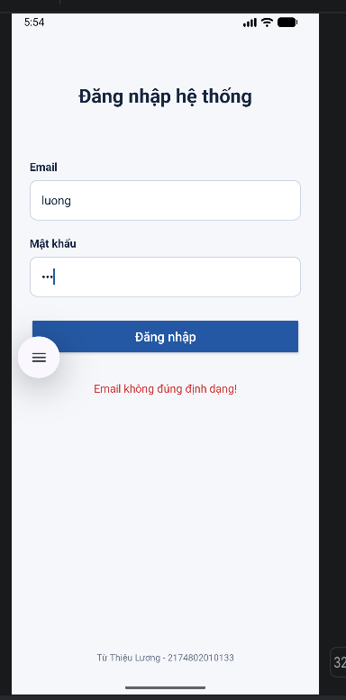
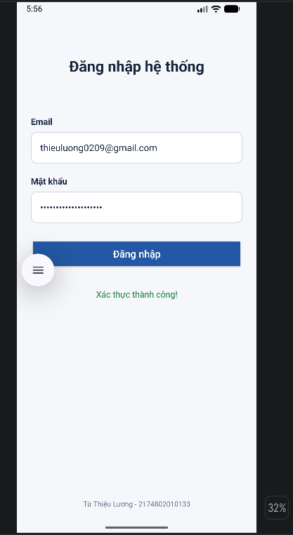
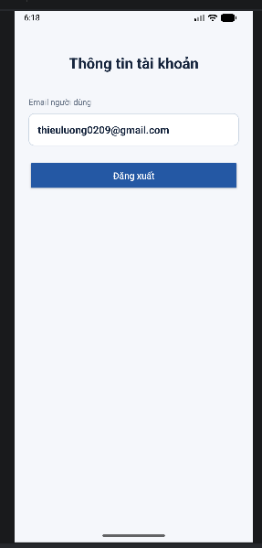
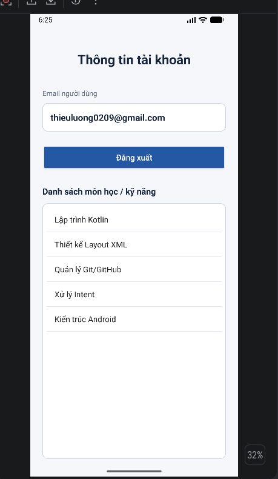
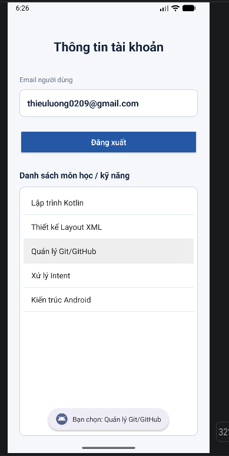

# BÀI KIỂM TRA THỰC HÀNH — CÂU 3

- Họ tên: **Từ Thiệu Lương**
- MSSV: **2174802010133**
- Branch: **`cau-3`**

## Nội dung thực hiện
Màn hình đăng nhập viết bằng Kotlin + ConstraintLayout XML; sử dụng `findViewById`, `Patterns.EMAIL_ADDRESS`, kiểm tra trống và mật khẩu tối thiểu 6 ký tự. Không dùng ViewBinding.

## Minh chứng Câu 1 (kế thừa)
**Dữ liệu lỗi (ví dụ email `abc`, mật khẩu `123`):**

**Dữ liệu hợp lệ (ví dụ `demo@example.com` và `123456`):**

## Minh chứng Câu 2
Nhập email và mật khẩu hợp lệ, nhấn Đăng nhập để mở ProfileActivity

## Minh chứng Câu 3
Đăng nhập hợp lệ, kiểm tra danh sách môn học trong ProfileActivity, sau đó nhấn một mục để hiện Toast.

**ListView:**

**Toast sau khi chọn một môn học:**

